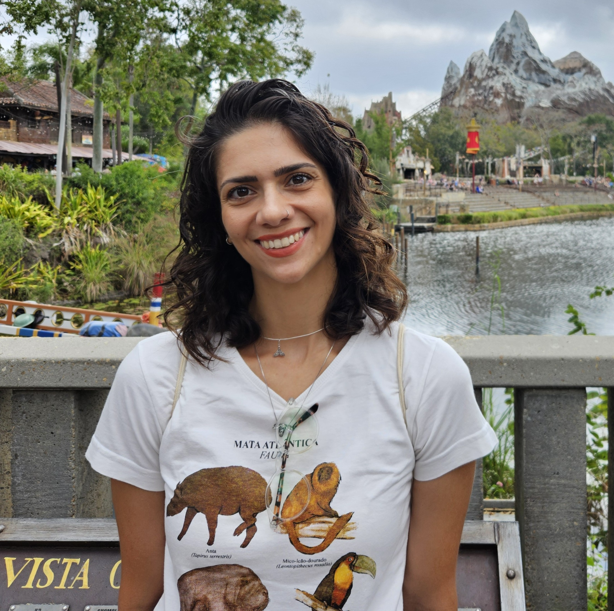
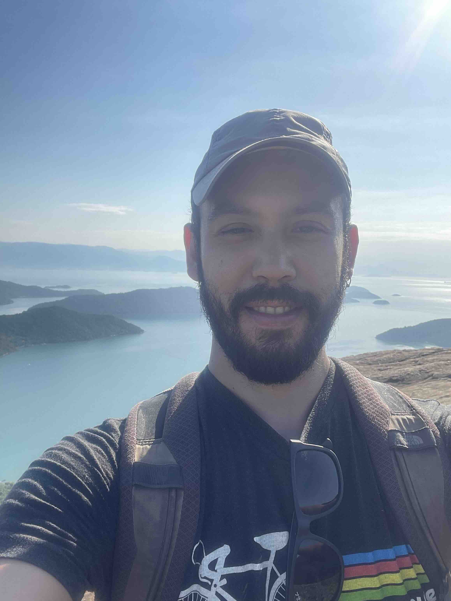
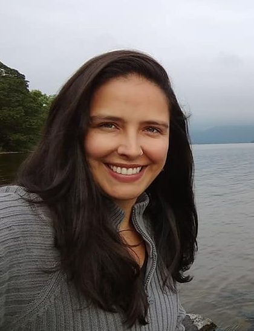

Olá!

Bem-vinda e bem-vindo a disciplina "**Princípios e Práticas de Reprodutibilidade na Pesquisa em Biodiversidade".** Nesta disciplina abordaremos conceitos relacionados ao movimento da Ciência Aberta, além das tendências e ferramentas necessárias para conduzir pesquisas reprodutíveis na área de ecologia e biodiversidade.

Este site conterá o conteúdo e cronograma da nossa aula. Assim como os materiais e scripts que utilizaremos durante o curso.

[Clique aqui](index.qmd) para uma visão completa do cronograma

# Ministrantes

O curso será ministrado é coordenado pela Dra. Ana Paula Lula Costa, e pelo Dr. Matheus Salles. Ainda, contará com a presença da Dra. Eduarda Centeno e pelo Dr. Gabriel Nakamura.

## Ana Paula Lula Costa

```{r echo=FALSE, eval=TRUE, out.width="20%"}


```

Formado em licenciatura em Ciências Biológicas (apesar da dúvida entre Ciências Sociais e História), fiz algumas andanças de difícil reprodutibilidade para obter o mestrado (Ecologia e Conservação UFMS) e doutorado (Ecologia UFRGS). Após um tempo fora (posdoc Texas A&M University), a saudade do pequi e da guariroba do cerrado falou mais alto e retornei como posdoc da Universidade Federal de Goiás no INCT-EECBio e depois como posdoc na Universidade de São Paulo (USP). Atualmente sou professor na Universidade Federal de Minas Gerais (UFMG). Venho desenvolvendo métodos e ferramentas computacionais em macroecologia e macroevolução. [Aqui](http://lattes.cnpq.br/2456515948049565) um pouquinho mais do que venho desenvolvendo.

## Gabriel

```{r echo=FALSE,eval=TRUE,out.width="20%"}

```

Formado em licenciatura em Ciências Biológicas (apesar da dúvida entre Ciências Sociais e História), fiz algumas andanças de difícil reprodutibilidade para obter o mestrado (Ecologia e Conservação UFMS) e doutorado (Ecologia UFRGS). Após um tempo fora (posdoc Texas A&M University), a saudade do pequi e da guariroba do cerrado falou mais alto e retornei como posdoc da Universidade Federal de Goiás no INCT-EECBio e depois como posdoc na Universidade de São Paulo (USP). Atualmente sou professor na Universidade Federal de Minas Gerais (UFMG). Venho desenvolvendo métodos e ferramentas computacionais em macroecologia e macroevolução. [Aqui](http://lattes.cnpq.br/2456515948049565) um pouquinho mais do que venho desenvolvendo.

## Eduarda Centeno

```{r echo=FALSE,eval=TRUE,out.width="20%"}

```

Sou ecóloga e cientista de dados na Universidade de Regemsbirg. Tenho graduação em biologia (UFRJ), mestrado (UFRJ) e doutorado em Ecologia (USP). Acumulei também um MBA em Gestão Ambiental (Poli-USP) e MBA em Ciência de Dados (ESALQ-USP). Ao longo dos anos trabalhei em diferentes áreas da ecologia e biologia da conservação como ecologia da paisagem, de comunidades, de populações e ecologia aplicada. Tenho bastante interesse na aplicação métodos estatísticos para descobertas ecológicas (modelos mistos são meu xodó). Adoro escalada, trilhas e esportes de aventura no geral! Ah, e sou uma entusiasta do movimento da **Ciência Aberta**!! Para me achar e saber mais sobre mim, veja meu [site](https://melinaleite.weebly.com/).

## Matheus Salles

```{r echo=FALSE,eval=TRUE,out.width="20%"}

```

Sou ecóloga e cientista de dados na Universidade de Regemsbirg. Tenho graduação em biologia (UFRJ), mestrado (UFRJ) e doutorado em Ecologia (USP). Acumulei também um MBA em Gestão Ambiental (Poli-USP) e MBA em Ciência de Dados (ESALQ-USP). Ao longo dos anos trabalhei em diferentes áreas da ecologia e biologia da conservação como ecologia da paisagem, de comunidades, de populações e ecologia aplicada. Tenho bastante interesse na aplicação métodos estatísticos para descobertas ecológicas (modelos mistos são meu xodó). Adoro escalada, trilhas e esportes de aventura no geral! Ah, e sou uma entusiasta do movimento da **Ciência Aberta**!! Para me achar e saber mais sobre mim, veja meu [site](https://melinaleite.weebly.com/).
